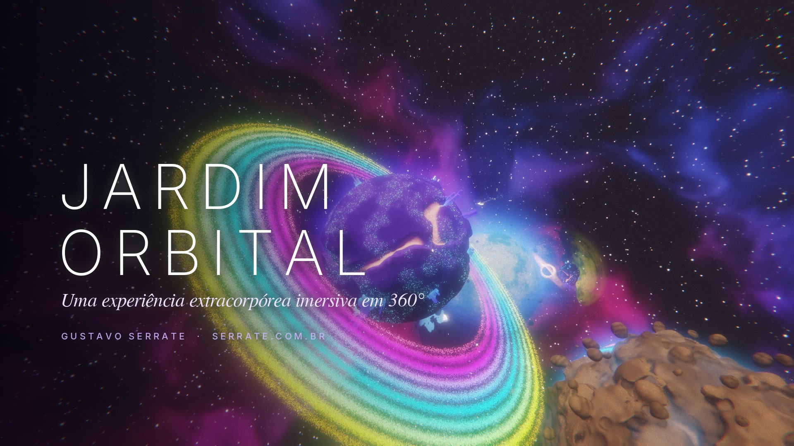

# Jardim Orbital



*Uma experiência extracorpórea imersiva em 360°.* Veja também [APRESENTACAO.md](APRESENTACAO.md).

Exploração em primeira pessoa num sistema de miniplanetas com gravidade baixa. Cada sistema nasce de uma semente: três planetas de biomas diferentes, céu de nebulosa e espíritos luminosos que passam em órbita. Tudo é gerado por código, sem imagens, modelos ou arquivos de som, num único `index.html`.

Baseado no [Abyssal Garden](https://github.com/Noniv/abyssal-garden) (MIT), de onde vêm o renderizador WebGPU, o bloom, a geração de malha por *surface nets* e o som sintetizado.

## Jogar

Abra o `index.html` no **Chrome** ou no **Edge** de um computador. É preciso ter WebGPU.

| | |
|---|---|
| Olhar | Mouse |
| Andar, flutuando devagar | `W` `A` `S` `D` |
| Pular · segurar no ar: planar | `Espaço` |
| Aura: voar para onde o mouse aponta | segure `Shift`; `W` acelera, `S` freia; ao soltar, você desliza até parar |
| No ar, mirando um planeta | segure `W`: você segue até ele e pousa |
| Cordão de prata | `R` ou botão direito: te puxa até a luz mais próxima ainda não vista, contornando os planetas; depois de todas, até o sol |
| Entrar na luz / voltar | `F` (perto de um quadrado de luz) |
| Respirar (câmera lenta) | segure `B` |
| Diário · foto | `J` · `P` |
| Órbita de cada planeta | `1` `2` `3` |
| Lanterna | `F` |
| Menu · som · cola de comandos e dados | `Esc` · `M` · `H` |

Cada planeta tem um clima, e o clima decide a música, a luz e a gravidade: **leve** (música clara, gravidade flutuante: um pulo dura uns 10 s), **enigmático** (música estranha, gravidade de Terra) e **sinistro** (música sombria, gravidade pesada). Do enigmático e do sinistro só se sai com a aura. Cada planeta segura o que está na sua esfera de influência; entre eles você deriva, e o "chão" vira suavemente quando você troca de mundo.

**Aura.** Segurando Shift, você pilota como uma nave: segurar a mesma direção aumenta a aceleração, e para frear é preciso empurrar no sentido contrário. Não há freio automático no espaço. Quanto mais rápido, mais turbulência, mais rastros e mais o campo de visão se abre.

**A história.** O viajante não lembra quem foi. Cada planeta é um sentimento da vida dele: **Alegria**, **Desejo**, **Conquista**, **Arrependimento** e **Perda**. O peso do sentimento é a gravidade do planeta. Em cada um há um quadrado de luz; entre nele (`F`) e você vira um ponto parado dentro de uma cena simbólica daquela lembrança, olhando para onde quiser, pelo tempo que quiser, enquanto fragmentos de memória aparecem. O diário (`J`) guarda tudo o que você já viu e ouviu. O compêndio está em `source/src/story.js`: textos originais, escritos a partir de temas humanos recorrentes em discussões do Reddit sobre arrependimentos, alegrias pequenas, conquistas que ninguém viu, sonhos adiados e luto, sem citar nenhuma postagem.

**Almas.** Elas flutuam em órbita ou ficam sentadas perto da água. Algumas são luminosas, a maioria escura e translúcida. Chegue perto e olhe para uma: ela diz alguma coisa. São oito tipos (recém-desencarnados, nunca-nascidos, devotos, sábios, silenciosos, estranhos, melancólicos, antigos), com centenas de falas entre escritas e geradas por combinação (`source/src/souls.js`).

**Buraco negro.** Fica além dos planetas, com lente gravitacional, anel de fótons e disco de acreção. De longe a aura ainda vence a atração; abaixo de ~22 m ele te engole. A travessia dura de 2 a 3 minutos, com a realidade dobrada como um espelho d'água e pensamentos espaçados, e você sai do outro lado do sistema.

Cada sistema tem 5 planetas (4 no nível Baixo).

**O sol.** Há um jeito de terminar a viagem, e ele tem a ver com o sol. Mas é preciso lembrar antes de esquecer: quem chega cedo demais é mandado de volta.

`?seed=123` na URL fixa o sistema. O botão **Novo sistema** sorteia outro.

## Biomas

| | |
|---|---|
| **Prado** | grama verde, pontos de flor laranja, borda azul de atmosfera |
| **Cristal** | colunas violeta, arbustos roxos, faíscas ciano, trilhas salmão |
| **Escarpa** | rocha marrom em espinhos, água escura, névoa ciano, brasas |
| **Mármore** | chão em faixas de tinta rosa, laranja e azul, brilho molhado |
| **Jardim** | campos de flores rosa e violeta, torres de rocha, rochas flutuando |

## Código

```bash
cd source
npm install
npm run build            # index.html minificado
npm run build:readable   # sem minificar, para depurar
```

| Arquivo | O que tem |
|---|---|
| `source/src/system.js` | O sistema a partir da semente: biomas, paletas, posições, gravidade |
| `source/src/world.js` | Malha e colisão de cada planeta, vegetação, cristais, rochas, espíritos |
| `source/src/shaders.js` | Todo o visual em WGSL: relevo, céu, atmosfera, água, plantas, espíritos, pós-processamento |
| `source/src/main.js` | Renderizador, física do jogador, controles, loop |
| `source/src/math.js` · `audio.js` · `quality.js` | Ruído e malhas, som, níveis de detalhe (do Abyssal Garden) |

Para teste automatizado num navegador sem placa de vídeo, `?headless` desenha fora do canvas, e `window.__game.snap()` devolve o quadro como PNG.
